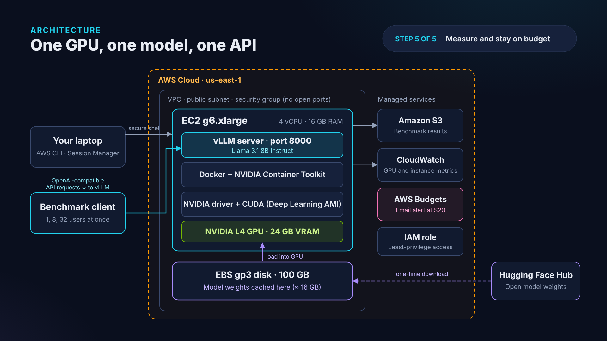

# Scenario 01: Serve an LLM on one GPU and size it

Run Meta's Llama 3.1 8B Instruct with vLLM on one NVIDIA L4 (24 GB) GPU on AWS, predict
its memory needs by hand, then prove the prediction with `nvidia-smi` and a load test.



| | |
| --- | --- |
| Instance | EC2 g6.xlarge: 1 × NVIDIA L4 24 GB, 4 vCPU, 16 GB RAM |
| Software | Deep Learning Base AMI, Docker, vLLM (OpenAI-compatible API) |
| Models | `meta-llama/Llama-3.1-8B-Instruct` (16-bit), `hugging-quants/Meta-Llama-3.1-8B-Instruct-AWQ-INT4` (4-bit) |
| Approx. cost | g6.xlarge ≈ $0.80/hour on demand in us-east-1; whole lab ≈ $5–15. Check current pricing. |

> Status: written from documentation, not yet run end to end. Expect to adjust the AMI
> parameter name and `vllm bench` flags for the current versions.

## 0. Predict first

```bash
python3 sizing/sizing.py --params 8 --layers 32 --kv-heads 8 --head-dim 128 --gpu-gb 24
python3 sizing/sizing.py --params 8 --layers 32 --kv-heads 8 --head-dim 128 --gpu-gb 24 --bits 4
```

16-bit: 16 GB of weights leaves ≈ 4 GB for KV cache, about 4 long (8K-token) chats at once.
4-bit: roughly 4× the room. (Real AWQ checkpoints are ≈ 5 GB because some layers stay 16-bit.)

## 1. Prepare (a day ahead)

1. Request GPU quota: `scripts/00-request-gpu-quota.sh` (Running On-Demand G and VT instances → 8 vCPUs).
2. Create an AWS Budget (for example $20/month) with email alerts.
3. Accept the Llama 3.1 license on Hugging Face and create a read token.
4. Create an IAM instance profile with `AmazonSSMManagedInstanceCore`, so you connect without SSH keys or open ports.

## 2. Launch

```bash
export INSTANCE_PROFILE=<your-ssm-profile>
scripts/01-launch.sh                       # asks before launching; billing starts here
aws ssm start-session --target <instance-id>
nvidia-smi                                 # empty 24 GB L4
```

## 3. Serve

Copy `scripts/` to the instance (or clone this repo there), then:

```bash
HF_TOKEN=<token> scripts/02-serve-vllm.sh fp16
docker logs -f vllm        # wait for "Application startup complete"; note the KV cache size
nvidia-smi                 # compare with the prediction
```

## 4. Test

```bash
scripts/03-test.sh
# From your laptop instead, forward the port through Session Manager:
aws ssm start-session --target <instance-id> --document-name AWS-StartPortForwardingSession \
  --parameters '{"portNumber":["8000"],"localPortNumber":["8000"]}'
```

## 5. Benchmark

```bash
scripts/04-benchmark.sh fp16
HF_TOKEN=<token> scripts/02-serve-vllm.sh awq && scripts/04-benchmark.sh awq
```

Record output tokens/s, time to first token and p95 latency at 1, 8 and 32 users.
Cost per million tokens = hourly price ÷ (tokens/s × 3,600) × 1,000,000.

## 6. Tear down

```bash
scripts/05-teardown.sh     # terminates everything tagged project=ai-infra-series
```

## Video intro

`video/slides.html` is the source of the episode intro (architecture build-up, plan, sizing,
glossary). To re-render:

```bash
cd video && mkdir -p frames && node render.js frames && python3 build.py . intro.mp4
```

Requires Node with Playwright (Chromium) and ffmpeg.
