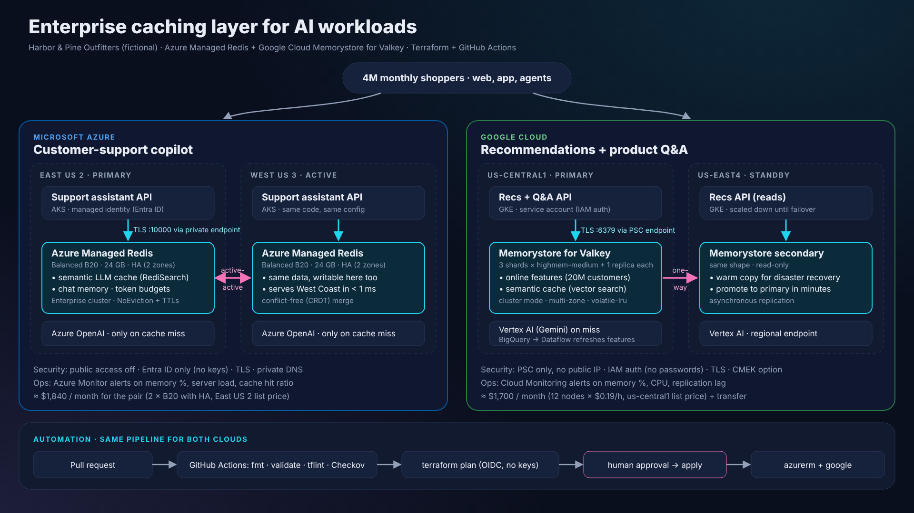

# Scenario 09: Design, build and automate an enterprise caching layer for AI

A real-life enterprise scenario: a retailer runs AI on two clouds and puts a managed
in-memory cache in front of it on each. We design it like an architect (sizing, high
availability, disaster recovery, security, cost), build it by hand in the Azure portal and
the Google Cloud console, then automate the same thing with Terraform and GitHub Actions.



| | |
| --- | --- |
| Azure | **Azure Managed Redis** (Balanced tier, RediSearch module, active geo-replication) |
| Google Cloud | **Memorystore for Valkey** (cluster mode, vector search, cross-region replication) |
| App | Python: semantic LLM cache, chat memory, token budgets, online features ([`app/`](app/)) |
| Automation | Terraform for both clouds ([`terraform/`](terraform/)), CI in [`.github/workflows/scenario-09-iac.yml`](../../.github/workflows/scenario-09-iac.yml) |
| Lab cost | ≈ $2–5 for a 3-hour session on each cloud, then tear down. Production design ≈ $3,500/month. |

> **Status:** written from current documentation and tested locally against Redis 8.2 and
> Valkey 8.1 (valkey-bundle) containers. Terraform passes `terraform validate` with azurerm
> 5.14 and google 8.11. Not yet run in a real Azure or Google Cloud account. Portal labels move
> around; if one differs, look for the setting by name.

**Walkthroughs:** [Azure portal](docs/azure-portal-walkthrough.md) ·
[Google Cloud console](docs/gcp-console-walkthrough.md) ·
[Automation](docs/automation.md) · [Azure vs. Google](docs/comparison.md) ·
[Video plan](docs/video-plan.md) · [Blog outline](docs/blog-outline.md)

---

## 1. The business story

*Harbor & Pine Outfitters is fictional. The numbers are illustrative but realistic.*

Harbor & Pine sells outdoor gear to about 4 million customers a month. Two AI products
went live this year, on two clouds, because the company bought a startup that ran on Google
Cloud:

- **Support copilot (Azure).** A chat assistant on Azure OpenAI answers questions about
  orders, returns and products. It handles 2 million conversations a month.
- **Recommendations and product Q&A (Google Cloud).** A model on Vertex AI ranks products
  for each shopper and answers product questions with Gemini.

Six months in, the CTO sees four problems:

1. **The LLM bill.** About $180,000 a month, and climbing. Analysis of the logs shows that
   roughly 40% of questions are the same few hundred questions asked in different words
   ("What is your return policy?", "how do returns work?").
2. **Slow answers.** Typical answers take 2 to 6 seconds. Repeated questions don't need to.
3. **Rate limits on peak days.** On Black Friday the support copilot hit the model provider's
   tokens-per-minute limit and started failing.
4. **Recommendations miss their latency budget.** The ranking model needs about 40 features
   per customer (lifetime value, recent orders, favorite category) in under 10 ms. Reading
   them from the data warehouse takes seconds.

**The decision:** add a managed cache in front of the AI on each cloud, run it in two
regions, keep it private, and build it with code so both clouds follow the same rules.

**Targets:** cut LLM calls by 30% or more, answer repeated questions in under 50 ms, feature
reads under 5 ms at p99, 99.99% availability, survive the loss of a whole region, and no
passwords or public endpoints anywhere.

## 2. What the cache does (four jobs)

| Job | What it stores | Why | Where |
| --- | --- | --- | --- |
| **Semantic LLM cache** | Question embedding + the answer, with a TTL | Same meaning → reuse the answer; no LLM call | Both clouds |
| **Chat memory** | The last 20 messages of each conversation | Any app instance can continue any chat | Azure |
| **Token budgets** | Tokens used per tenant per minute | Shared rate limit across all app instances | Azure |
| **Online features** | Per-customer feature hashes, refreshed by a pipeline | Millisecond reads for the ranking model | Google Cloud |

How the semantic cache answers a question ([`app/semantic_cache.py`](app/semantic_cache.py)):

1. **Exact match.** Hash the normalized question; if the hash is in the cache, return the
   answer. Cost: one key lookup.
2. **Semantic match.** Turn the question into an embedding (a list of numbers that captures
   its meaning) and ask the cache's vector index for the nearest stored question. If it is
   closer than a threshold, return that answer.
3. **Miss.** Call the LLM, return the answer, and store it with a TTL for next time.

Four rules make it safe for an enterprise:

- **Scope every lookup** by tenant, model and prompt version, so a customer never gets
  another tenant's answer, and a new prompt template never serves old answers.
- **Only cache shareable answers.** Policy questions yes; "where is *my* order" never.
  The app decides what is cacheable before it stores anything.
- **Pick the threshold with data.** `python3 app/demo.py --sweep` shows, for each threshold,
  how many paraphrases get served and how many *trap* questions ("Is the Ridgeline **4**
  tent waterproof?" vs. "Ridgeline **2**") wrongly get served. Choose the highest threshold
  with zero wrong answers, then put details that matter (product ID, country) into the scope.
- **Fail open.** If the cache is down or full, log it and call the LLM. The cache can make
  things faster; it must never make them fail.

## 3. Design decisions

### Azure: Azure Managed Redis

| Decision | Choice | Why |
| --- | --- | --- |
| Tier | **Balanced** | Mixed read/write chat traffic; Memory Optimized is for large, cold datasets, Compute Optimized for very high throughput |
| Size | **B20 (24 GB)** | Sizing below needs ≈ 12 GB today. B10 would be full on day one; B20 leaves room for Black Friday and growth |
| Module | **RediSearch** | Vector search for the semantic cache. Must be chosen at creation |
| Clustering policy | **Enterprise** | Required by RediSearch; one endpoint, so a normal (non-cluster) client works |
| Eviction | **NoEviction** | Required by RediSearch. Every key gets a TTL, and alerts fire at 75% memory |
| High availability | **On** | A replica in another zone; needed for the SLA and for geo-replication |
| Regions | **East US 2 + West US 3, active-active** | Both regions read and write; conflicts are merged automatically (CRDTs). Up to 5 regions per group |
| Persistence | **Off** | It's a cache; the source of truth is elsewhere. (Persistence also can't be combined with geo-replication) |
| Network | **Public access disabled, private endpoints**, private DNS zone `privatelink.redis.azure.net` | Nothing reachable from the internet |
| Sign-in | **Microsoft Entra ID only, access keys disabled** | No shared secrets to leak or rotate; each app has a managed identity |

### Google Cloud: Memorystore for Valkey

| Decision | Choice | Why |
| --- | --- | --- |
| Engine | **Valkey 8.0** | Open-source (Linux Foundation) fork of Redis, wire-compatible, with built-in vector search |
| Mode | **Cluster mode enabled** | Scale out by adding shards; 20M customer feature records will grow |
| Shape | **3 shards × highmem-medium (13 GB), 1 replica per shard** | ≈ 21 GB needed (sizing below); 31 GB writable leaves headroom |
| Zones | **Multi-zone** | Primary and replica of each shard in different zones; automatic failover |
| Eviction | **volatile-lru** | Every key has a TTL; under pressure the least-recently-used keys go first |
| Disaster recovery | **Cross-region secondary in us-east4** | Read-only copy, replicated asynchronously; promote it if us-central1 fails |
| Persistence | **Off** | Features can be reloaded from BigQuery; answers can be regenerated |
| Network | **Private Service Connect** via a service connection policy | Private IPs inside our VPC; no peering, no public IP |
| Sign-in | **IAM authentication** + TLS (per-instance CA) | Service accounts with `roles/memorystore.dbConnectionUser`; tokens expire hourly |

### Why not one cache for both clouds?

Cross-cloud round trips add 20–60 ms and egress fees to every lookup, and a single cache
would be a single point of failure for both products. Each product's cache sits next to its
compute. What is shared is the **design, the code, and the pipeline**: the same app code
runs on both (Redis and Valkey speak the same protocol), and the same Terraform workflow
builds both.

## 4. Sizing

```bash
python3 sizing/cache_sizing.py                      # Azure: support copilot
python3 sizing/cache_sizing.py --entries 500000 --dim 768 --sessions 0 \
    --feature-keys 20000000 --feature-bytes 400      # Google Cloud: recs + product Q&A
```

**Azure (support copilot):** 1 million cached answers with 512-dimension embeddings
(≈ 6.6 KB each, because a vector is stored twice: in the hash and in the index), plus
200,000 live chat sessions at 8 KB → **8.2 GB of data, 11.7 GB with 30% free space.**
That fits B10 with nothing to spare, so we choose **B20**.

**Embedding size is the biggest lever.** The same cache with 1,536-dimension embeddings
needs 23 GB. Models that can return shorter vectors cut memory by two thirds. Test answer
quality before you shrink them.

**Google Cloud (recs + Q&A):** 20 million customer feature records at ≈ 520 bytes plus
500,000 cached answers → **14.7 GB, 21 GB with headroom → 3 × highmem-medium shards.**

Then verify with real data: load a sample, run `INFO memory` and `FT.INFO`, and correct the
script's inputs.

## 5. High availability and disaster recovery

| Failure | Azure Managed Redis | Memorystore for Valkey |
| --- | --- | --- |
| One node or zone | Replica in another zone takes over automatically | Replica in another zone takes over automatically |
| Whole region | Traffic Manager / Front Door sends users to the other region; its cache is already active and writable | Promote the us-east4 secondary to primary, point the app at it |
| Data lost in a region | Re-synced from the other region | Reloaded from BigQuery by the feature pipeline; answers regenerate on misses |
| Cache down entirely | App fails open to the LLM (slower, costs more, still works) | Same |

Write it down as targets: **RPO** (how much data you can lose) is seconds for both, since
replication is asynchronous; **RTO** (how long until service is back) is near zero on Azure
(active-active) and minutes on Google Cloud (promotion).

Practice it: the lab's [`app/replication_check.py`](app/replication_check.py) measures
replication lag, and each walkthrough ends with a failover drill.

## 6. Security checklist

- [x] No public endpoint (Azure: public network access disabled; Google: PSC only).
- [x] No passwords or access keys (Entra ID managed identity; Google IAM service account).
- [x] TLS in transit everywhere (Azure port 10000; Google per-instance CA).
- [x] Encryption at rest is on by default; customer-managed keys are available on both
      (`customer_managed_key` / `kms_key`) when policy requires them.
- [x] Least privilege: one identity per app, data-plane role only.
- [x] No personal data in the semantic cache; scope keys by tenant.
- [x] Everything tagged `project=ai-infra-series`, `scenario=09` for cost tracking.
- [x] CI scans the Terraform with Checkov; plans run with OIDC, so no cloud keys live in GitHub.

## 7. Cost

**Production design (list prices, pay as you go, checked November 2026):**

| Item | Monthly |
| --- | --- |
| Azure Managed Redis B20 with HA, East US 2 | ≈ $918 |
| Azure Managed Redis B20 with HA, West US 3 | ≈ $918 (check the regional price) |
| Memorystore for Valkey, 3 shards × highmem-medium + 3 replicas, us-central1 | ≈ $842 (6 nodes × $0.1923/h) |
| Memorystore secondary, same shape, us-east4 | ≈ $842 + cross-region transfer ($0.02/GiB) |
| Private endpoints, monitoring | ≈ $50 |
| **Total** | **≈ $3,570 / month** |

**What it saves:** if 30% of support-copilot LLM calls become cache hits, the $180,000
monthly LLM bill drops by about **$54,000**. The cache pays for itself many times over, and
users get repeated answers in milliseconds instead of seconds. One-year reservations (Azure)
and committed use discounts (Google, 20% for 1 year, 40% for 3) cut the cache bill further.

**Lab (this repo):**

| | Per hour | 3-hour session |
| --- | --- | --- |
| Azure: B3 cache with HA ($0.13), B2s VM, NAT gateway, private endpoint, Bastion Developer (free) | ≈ $0.24 | ≈ $0.75 |
| Azure, plus second region for geo-replication | ≈ $0.40 | ≈ $1.20 |
| Google: shared-core-nano node ($0.032), e2-medium VM, Cloud NAT | ≈ $0.08 | ≈ $0.25 |
| Google, plus cross-region secondary | ≈ $0.12 | ≈ $0.35 |

Set a budget alert on both clouds first (for example $20/month each), and delete everything
at the end of each session. Sources: the Azure Managed Redis
[pricing page](https://azure.microsoft.com/pricing/details/managed-redis/) and
[Memorystore for Valkey pricing](https://cloud.google.com/memorystore/docs/valkey/pricing).
Prices change; check them before you build.

## 8. The lab

| Part | What you do | Guide |
| --- | --- | --- |
| A | Build the Azure side in the portal: network, cache, identity, test VM | [Azure walkthrough](docs/azure-portal-walkthrough.md) |
| B | Build the Google side in the console | [Google Cloud walkthrough](docs/gcp-console-walkthrough.md) |
| C | Run the same app on both: threshold sweep, with/without cache, traps, patterns | Both walkthroughs, "Run the demo" |
| D | Add a second region and run a failover drill | Both walkthroughs, last steps |
| E | Delete it all, then rebuild it with one command each: Terraform + CI | [Automation](docs/automation.md) |

What to record for the video and blog:

- `demo.py --sweep`: the threshold table (paraphrases served vs. traps served).
- `demo.py --no-cache -n 60` vs. `demo.py -n 300`: p50/p95 latency, hit rate, LLM spend.
- `demo.py --traps`: which near-miss questions the cache correctly refused.
- `patterns_demo.py`: feature-read p50/p99 in milliseconds.
- `replication_check.py`: replication lag between regions.
- Portal metrics: used memory, cache hits/misses, connected clients.

**Found while testing:** a local valkey-search 8.1 build returned the KNN score rounded to
whole numbers, so the code recomputes the distance from the stored vector instead of
trusting the engine's score. That makes it behave the same on both engines.

## 9. Files

```
scenarios/09-enterprise-ai-caching/
  README.md                      this design
  architecture-diagram.png       rendered from video/architecture.html
  docs/                          portal walkthroughs, automation, comparison, video plan, blog outline
  app/                           demo app (runs on both clouds, configured by environment variables)
  sizing/cache_sizing.py         memory calculator
  terraform/azure/               Azure Managed Redis, geo-replication, private endpoints, test VM
  terraform/gcp/                 Memorystore for Valkey, cross-region secondary, PSC, test VM
  video/                         diagram source and render script
```
